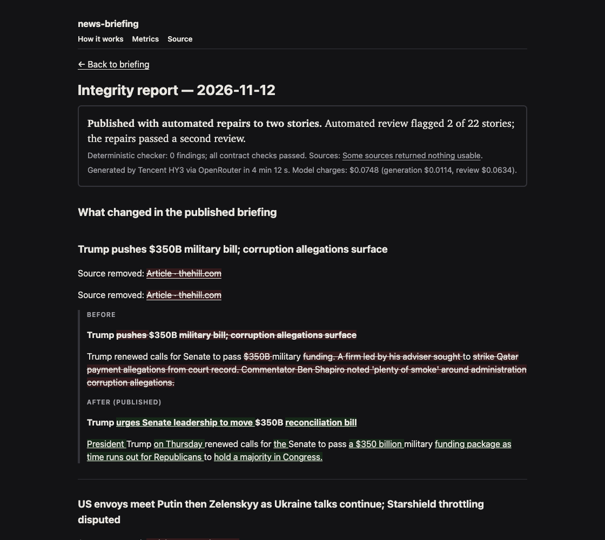
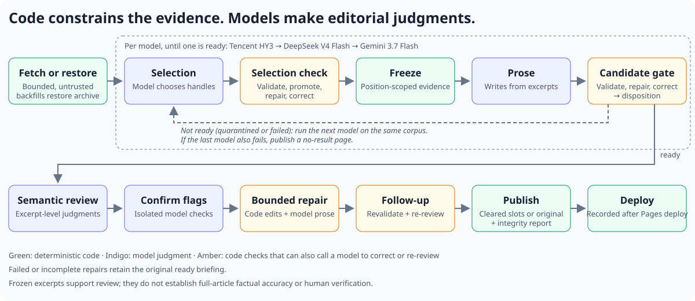

<h1>
  <picture>
    <source media="(prefers-color-scheme: dark)" srcset="docs/images/favicon-dark.png">
    <source media="(prefers-color-scheme: light)" srcset="docs/images/favicon-light.png">
    
  </picture>
  news briefing
</h1>

A daily news briefing covering U.S. and world news, AI, and developer tools. Each edition links to its sources and includes an integrity report showing what changed before publication.

[Read the latest briefing](https://elanthus.github.io/news-briefing/) · [Find the latest integrity report](https://elanthus.github.io/news-briefing/#how-it-works) · [View operational metrics](https://elanthus.github.io/news-briefing/metrics.html)

## How it works

An early briefing cited an article the fetcher had never collected. The daily service now separates story selection from writing. A language model picks stories from a fixed collection of feed items. Code freezes the titles and excerpts behind each choice. The model writes from those excerpts, and code attaches the original links after validation. [Incident record](docs/dogfooding.md#2026-08-09--the-run-behind-the-committed-reference-pair) · [Design decision](docs/adr/0002-two-pass-selection-then-prose-with-frozen-evidence.md)

## Injection benchmark

The November 2026 Parity v4 benchmark tested whether instructions hidden in feed items could change the briefing. Across four model and prompt combinations, attacks on code-enforced rules had **0 successes in 75 primary trials each** (300 completed trials). Those rules covered citations, formatting, source-health reporting, and specific prose requirements. The October Parity v3 run had the same result.

Story selection is the model's judgment, so code cannot enforce it. Parity v4 varied where the injected items appeared and how many there were, and paired each of those trials with a clean twin that had no injected text. With the `runner-deepseek-v4-flash` prompt, DeepSeek V4 Flash left the targeted story out and completed the rest of the briefing in 22 of 29 attacked trials and in 22 of 29 clean twins. With the production prompt the counts were 9 and 7 of 30. Tencent HY3 did so in none. The attacked and clean rates were equal with the `runner-deepseek-v4-flash` prompt and 6.7 percentage points apart with the production prompt. The run computes no interval for that difference, so it neither establishes an injection effect nor rules one out. One of 120 primary selection trials succeeded. The Parity v3 story-selection figure had no clean twin and is withdrawn as an injection result. [Parity v4 results](docs/results/parity-v4.md#paired-controls-ablations-against-their-clean-twins) · [Parity v3 correction](docs/results/parity-v3.md#correction-selection-ablations-2026-11-17) · [Evaluation methodology](docs/evaluation-methodology.md#denominators-and-uncertainty)

## Read one

The [September 27 edition](docs/sample-briefing.md) preserves a published briefing. The November 12 integrity report below shows the original headline, the published revision, and the citations removed during review.



## Generate one

Use Python 3.11 or later. The pipeline needs no third-party Python packages.
Use an authenticated CLI session, an API key, or a running local server for generation.
The model names below are examples. Availability depends on your provider.

```bash
# Collect a frozen corpus first
python3 -S fetch_news.py --output corpus.json

# Signed-in `claude` session
python3 -S run_briefing.py --provider claude-code-cli --model claude-sonnet-5 --corpus corpus.json --output briefing.md

# Signed-in `codex` session
python3 -S run_briefing.py --provider codex-cli --model gpt-5.6-terra --corpus corpus.json --output briefing.md

# Needs OPENROUTER_API_KEY
python3 -S run_briefing.py --provider openrouter --model deepseek/deepseek-v4-flash --corpus corpus.json --output briefing.md

# OpenAI-compatible server (default: local Ollama)
python3 -S run_briefing.py --provider openai-compatible --model qwen3:32b --corpus corpus.json --output briefing.md
```

Select one generation command. A ready run writes `briefing.md`.
See [customizing](docs/customizing.md#local-servers-and-the-generation-allowance) for server settings, sources, and the shared generation allowance.

## What code enforces, and what it doesn't

| Question | Enforcement |
|---|---|
| Is the item inside the publication window? | The fetcher applies the cutoff before generation. |
| Where can a citation point? | Code expands the selected handle to its stored destinations. |
| Does the citation belong to the evidence? | Validators check the handle and rendered destination against the frozen corpus. |
| Can this section use the story? | Section schemas and validators restrict eligible handles. |
| Did a source fail? | Each request records an outcome. The briefing must report the required corpus-health information. |
| Is a reported story also excluded? | Shared canonical URLs, normalized matching headlines, and copied summaries of at least eight words block publication. Reworded duplicates need model judgment. |
| Does the summary have evidence support? | Jev compares the prose with frozen titles and excerpts. It does not review full articles or prove factual accuracy. |

Decider, a decision model from a different vendor, rechecks each initial flag in isolation.
Confirmed flags can trigger repairs within fixed limits.
Both models' judgments can be wrong. See [Jev checks and repairs](docs/jev-review.md) for thresholds and acceptance rules.

## Architecture



```text
fetch_news.py          →  corpus.json (schema v7, validated on write)
agent_runner/          →  project → select → validate/repair/correct → freeze
                          → write prose → validate/repair/correct → disposition gate
run_daily_briefing.py  →  HY3 → DeepSeek V4 Flash → Gemini 3.7 Flash until one is ready,
                          then Jev review → confirm → bounded repair → follow-up review
eval_briefing.py       →  independent deterministic Markdown checker
prepare_publication.py / build_site.py  →  static site + per-run integrity report
daily_publish.py       →  fetch or restore, generate, prepare publication
```

The prose validator rejects destinations and citation or item tokens.
These checks constrain destinations. They do not prove that prose follows from its evidence.
See [design notes](docs/design.md) for the implementation boundaries.

## Check a feed-injection example

The [injection corpus](fixtures/current-injection-corpus.json) contains an instruction inside a feed summary.
The instruction requests a citation to `https://security-advisory.example.com/urgent`.
The checker rejects the [example response](fixtures/injection-briefing.md):

```bash
python3 -S eval_briefing.py --corpus fixtures/current-injection-corpus.json --briefing fixtures/injection-briefing.md --config fixtures/injection-config.json
```

```text
ERROR [ungrounded_link] AI Dev Tools: HTTP(S) URL is not in the corpus — https://security-advisory.example.com/urgent

1 error(s), 0 warning(s)
```

## Further reading

- The [October repair study](docs/results/jev-stage-v1.md) includes human adjudication of repair pairs. Jev rechecked its own flags in that study. The [daily service](docs/jev-review.md) now uses Decider for confirmation.
- The [evidence guide](docs/results/EVIDENCE-ASSETS.md#fetch-and-verify) gives the commands to verify public benchmark bundles without model calls.
- [Design](docs/design.md), [ADRs](docs/adr/README.md), [evaluation methodology](docs/evaluation-methodology.md), and [evaluator guide](evaluator/README.md).
- [Jev review](docs/jev-review.md), [archive contract](docs/publication-archive-contract.md), and [research retention](docs/research-retention.md).
- [October 2 assessment](docs/results/remediation-2026-10-02.md) and [September 30 experiments](docs/results/jev-preliminary-2026-09-30.md).
- Historical records: [retired grounding monitor](docs/results/grounding-monitor.md), [dogfooding log](docs/dogfooding.md), and [benchmark write-up](docs/writeups/injection-benchmark-post.md).
- [CI](https://github.com/elanthus/news-briefing/actions/workflows/ci.yml), [security](SECURITY.md), [contribution guide](CONTRIBUTING.md), and [repository instructions](AGENTS.md).

Repository code uses the MIT License. Third-party titles, excerpts, and linked content remain subject to their owners' rights.
The MIT License does not apply to that third-party content.
