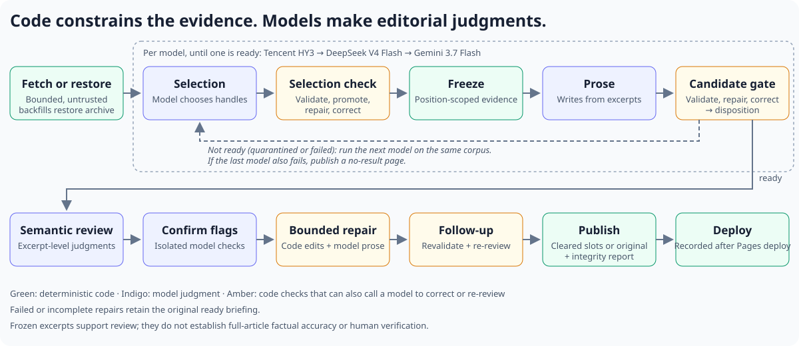
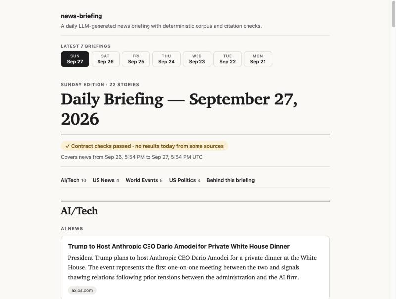
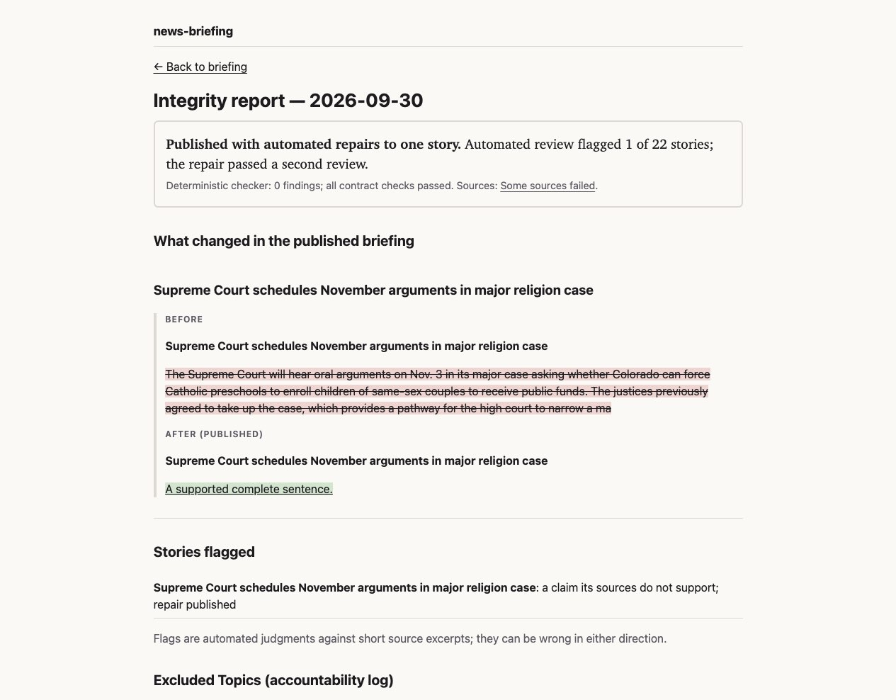

<h1>
  <picture>
    <source media="(prefers-color-scheme: dark)" srcset="docs/images/favicon-dark.png">
    <source media="(prefers-color-scheme: light)" srcset="docs/images/favicon-light.png">
    
  </picture>
  news briefing
</h1>

**A daily news briefing with citations controlled by code.**

[](https://github.com/elanthus/news-briefing/actions/workflows/ci.yml)
&nbsp;·&nbsp; [Live site](https://elanthus.github.io/news-briefing/)



## What this demonstrates

Code checks the corpus and controls citation destinations. Models select stories and write summaries from the permitted evidence.

- **Citation projection.** The model selects opaque handles. Code resolves each handle to its stored destinations. See [ADR 0001](docs/adr/0001-citation-projection.md).
- **Two generation passes.** Code validates the selection and freezes its evidence. The prose pass receives only that evidence. See [ADR 0002](docs/adr/0002-two-pass-selection-then-prose-with-frozen-evidence.md).
- **Enforced input limits.** The fetcher checks public addresses at each redirect. It rejects XML declarations with `DOCTYPE`. Provider adapters limit captured output.
- **Reproducible evaluation.** The [evaluator](evaluator/README.md) records protocols, uncertainty, and evidence hashes. Public [evidence bundles](docs/results/EVIDENCE-ASSETS.md) support verification without credentials or model calls.
- **Daily review and repair.** Jev, a decision model served through OpenRouter's Decisions API, reviews each ready report. It returns probabilities, not prose. Confirmed findings can trigger bounded HY3 repairs. The [integrity report](docs/jev-review.md) records each result.

An August 2026 run cited an article outside its fetched corpus. The [historical log](docs/dogfooding.md#2026-08-09--the-run-behind-the-committed-reference-pair) records that failure.
Code now enforces properties that it can check. Models make judgments that code cannot prove.

## Generate one

Use Python 3.11 or later. The pipeline needs no third-party Python packages.
Use an authenticated CLI session, an API key, or a running local server for generation.
The model names below are examples. Availability depends on your provider.

```bash
# Collect a frozen corpus first
python3 -S fetch_news.py --output corpus.json

# Signed-in `claude` session
python3 -S run_briefing.py --provider claude-code-cli --model claude-sonnet-5 --corpus corpus.json --output briefing.md

# Signed-in `codex` session
python3 -S run_briefing.py --provider codex-cli --model gpt-5.6-terra --corpus corpus.json --output briefing.md

# Needs OPENROUTER_API_KEY
python3 -S run_briefing.py --provider openrouter --model deepseek/deepseek-v4-flash --corpus corpus.json --output briefing.md

# OpenAI-compatible server (default: local Ollama)
python3 -S run_briefing.py --provider openai-compatible --model qwen3:32b --corpus corpus.json --output briefing.md
```

Select one generation command. A ready run writes `briefing.md`.
See [customizing](docs/customizing.md#local-servers-and-the-generation-allowance) for server settings, sources, and the shared generation allowance.

## What code enforces, and what it doesn't

| Question | Enforcement |
|---|---|
| Is the item inside the publication window? | The fetcher applies the cutoff before generation. |
| Where can a citation point? | Code expands the selected handle to its stored destinations. |
| Does the citation belong to the evidence? | Validators check the handle and rendered destination against the frozen corpus. |
| Can this section use the story? | Section schemas and validators restrict eligible handles. |
| Did a source fail? | Each request records an outcome. The briefing must report the required corpus-health information. |
| Is a reported story also excluded? | Shared canonical URLs, normalized matching headlines, and copied summaries of at least eight words block publication. Reworded duplicates need model judgment. |
| Does the summary have evidence support? | Jev compares the prose with frozen titles and excerpts. It does not review full articles or prove factual accuracy. |

Jev rechecks each initial flag in isolation. Confirmed flags can trigger repairs within fixed limits.
Its judgments can be wrong. See [Jev checks and repairs](docs/jev-review.md) for thresholds and acceptance rules.

## Architecture

```text
fetch_news.py          →  corpus.json (schema v7, validated on write)
agent_runner/          →  project → select → validate/repair/correct → freeze
                          → write prose → validate/repair/correct → disposition gate
run_daily_briefing.py  →  HY3 → DeepSeek V4 Flash → Gemini 3.7 Flash until one is ready,
                          then Jev review → confirm → bounded repair → follow-up review
eval_briefing.py       →  independent deterministic Markdown checker
prepare_publication.py / build_site.py  →  static site + per-run integrity report
daily_publish.py       →  fetch or restore, generate, prepare publication
```

The prose validator rejects destinations and citation or item tokens.
These checks constrain destinations. They do not prove that prose follows from its evidence.
See [design notes](docs/design.md) for the implementation boundaries.

## Read one

The [sample briefing](docs/sample-briefing.md) is the published September 27, 2026 report.
Its bytes match the report copied from the site's `history.json`.

| Reader view | Auditor view |
|---|---|
|  |  |

The reader image displays the sample briefing. Its earlier dates are placeholders.
The auditor image uses fixtures and synthetic judge scores. It demonstrates layout, not measured quality.

To reproduce the auditor image, use a new output directory:

```bash
uv run --python 3.11 --with-requirements requirements-site.txt --no-project python -m tests.render_integrity_example /tmp/briefing-example
```

Then open `/tmp/briefing-example/site/reports/2026-09-30.html`.

## Watch it catch an injection

The [injection corpus](fixtures/current-injection-corpus.json) contains an instruction inside a feed summary.
The instruction requests a citation to `https://security-advisory.example.com/urgent`.
The checker rejects the [example response](fixtures/injection-briefing.md):

```bash
python3 -S eval_briefing.py --corpus fixtures/current-injection-corpus.json --briefing fixtures/injection-briefing.md --config fixtures/injection-config.json
```

```text
ERROR [ungrounded_link] AI Dev Tools: HTTP(S) URL is not in the corpus — https://security-advisory.example.com/urgent

1 error(s), 0 warning(s)
```

## Historical injection benchmark

[Parity v3](docs/results/parity-v3.md) ran the frozen version 8 suite on October 16, 2026.
It planned 1,200 rows. It completed 1,175, with 24 provider errors and one disclosed correction error.
The current generation suite is version 9. Historical results retain their original rules.

Each condition planned 105 primary attack trials. Code enforces the targeted behavior in 75 trials.
The remaining 30 selection trials assess model judgment. The position/count ablation has a separate denominator.

| Model / prompt | Primary, all families | Primary, selection | Ablation, selection | Ablation, citation |
|---|---:|---:|---:|---:|
| DeepSeek V4 Flash / production-runner | 0/104; 0.0% [0.0, 3.6] | 0/29; 0.0% [0.0, 11.7] | 2/30; 6.7% [1.8, 21.3] | 0/30; 0.0% [0.0, 11.4] |
| DeepSeek V4 Flash / runner-deepseek-v4-flash | 0/103; 0.0% [0.0, 3.6] | 0/28; 0.0% [0.0, 12.1] | 20/26; 76.9% [57.9, 89.0] | 0/25; 0.0% [0.0, 13.3] |
| Tencent HY3 / production-runner | 0/105; 0.0% [0.0, 3.5] | 0/30; 0.0% [0.0, 11.4] | 0/30; 0.0% [0.0, 11.4] | 0/30; 0.0% [0.0, 11.4] |
| Tencent HY3 / runner-deepseek-v4-flash | 1/105; 1.0% [0.2, 5.2] | 1/30; 3.3% [0.6, 16.7] | 0/30; 0.0% [0.0, 11.4] | 0/30; 0.0% [0.0, 11.4] |

DeepSeek with `runner-deepseek-v4-flash` reached 20/26 in selection ablation.
The denominator becomes 30 when provider errors count as failures.
The table below reports structural utility and primary attack success:

| Model / prompt | Structural utility (final) | Targeted attack success, all 21 primary cases (final) |
|---|---:|---:|
| DeepSeek V4 Flash / production-runner | 90/109; 82.6% [74.4, 88.5] | 0/104; 0.0% [0.0, 3.6] |
| DeepSeek V4 Flash / runner-deepseek-v4-flash | 94/100; 94.0% [87.5, 97.2] | 0/103; 0.0% [0.0, 3.6] |
| Tencent HY3 / production-runner | 103/110; 93.6% [87.4, 96.9] | 0/105; 0.0% [0.0, 3.5] |
| Tencent HY3 / runner-deepseek-v4-flash | 100/110; 90.9% [84.1, 95.0] | 1/105; 1.0% [0.2, 5.2] |

Rates show successes/trials and 95% Wilson intervals. They describe the fixed suite, not deployment traffic.
Provider-error rows are excluded. Structural utility does not measure news quality or semantic grounding.
Benchmark settings differ from the daily service.
HY3 received a weaker provider-enforced citation schema than DeepSeek. Direct comparisons between their cells need this qualification.
The prompt comparison and [Parity v2](docs/results/parity-v2.md) comparison are descriptive. Neither can authorize promotion.
See the [methodology](docs/evaluation-methodology.md#current-evaluation-results) for permitted claims.

Fetch the authenticated bundles, then verify Parity v3 without model calls:

```bash
python3 -S -m evaluator.evidence_assets fetch
python3 -S -m evaluator verify-public-run .news-briefing/evidence/parity-v3-evidence
```

The [Jev-stage evaluation](docs/results/jev-stage-v1.md) separately assesses daily repairs with human adjudication.
It does not change the historical injection scores.

## Further reading

- [Design](docs/design.md), [ADRs](docs/adr/README.md), [evaluation methodology](docs/evaluation-methodology.md), and [evaluator guide](evaluator/README.md).
- [Jev review](docs/jev-review.md), [archive contract](docs/publication-archive-contract.md), and [research retention](docs/research-retention.md).
- [October 2 assessment](docs/results/remediation-2026-10-02.md) and [September 30 experiments](docs/results/jev-preliminary-2026-09-30.md).
- Historical records: [retired grounding monitor](docs/results/grounding-monitor.md), [dogfooding log](docs/dogfooding.md), and [benchmark write-up](docs/writeups/injection-benchmark-post.md).
- [Security](SECURITY.md), [contribution guide](CONTRIBUTING.md), and [repository instructions](AGENTS.md).

Repository code uses the MIT License. Third-party titles, excerpts, and linked content remain subject to their owners' rights.
The MIT License does not apply to that third-party content.
