# Design notes

This document explains the pipeline boundaries and their implementation.
The [README](../README.md) summarizes the guarantees.
The [archive contract](publication-archive-contract.md) defines publication and retention.

## Fetching

### Context limits and accounting

The fetcher filters known broad feeds for relevance, canonicalizes tracking URLs, removes duplicates, and applies source and category caps.
It also limits each model-visible string, each source's serialized items, and the total retained items.
Titles and summaries truncate at Unicode boundaries. Oversized URLs are dropped rather than rewritten.

Each item consumes its serialized UTF-8 byte size, rounded up to a four-byte unit.
One ledger enforces the smaller of the byte ceiling and four times the legacy token ceiling.
The v7 token estimates are reporting fields. They do not control a separate token budget.

`processing` records fetched, retained, truncated, and dropped items per category.
It separates relevance, duplicate, cap, field, source, and global budget drops.
Post-date-parsing drops plus `kept` reconcile to `fetched`.
`undated_dropped` instead equals source `parsed_entries - dated_entries`, before `fetched` is measured.
This separate counter reveals date-parser failures that could otherwise resemble quiet sources.

### Source outcomes

`sources` records every configured request with these fields:

- Source type and identity.
- Request and HTTP-success flags.
- Parsed, dated, and retained entry counts.
- Retained bytes and token estimates.
- Status, typed errors, and latency.

`fetch_duration_ms` records the full retrieval phase.
Unexpected XML shapes and responses without parseable dates produce explicit `empty` outcomes.
`errors` contains the structured projection of each `empty` or `error` source.

A `quiet` source has successful HTTP retrieval and parsed, dated entries, but no retained entries after windowing or applicable filtering.
Hacker News points-floor drops count as filtered entries.
Quiet sources stay in `sources` but do not enter `errors` or model-visible failed-source records.
Coverage degrades when one category exceeds `QUIET_SOURCE_DEGRADED_THRESHOLD`, currently 3 quiet sources.
The threshold does not turn those sources into fetch errors.

Malformed Hacker News envelopes or unreadable JSON fail the source.
Malformed individual hits do not discard valid stories.
The source instead reports `error_type: "MalformedEntries"` and a malformed-entry count.
This status takes precedence over `empty` and `quiet`.
Non-object hits are not recognized entries. A timestamp counts as dated only after successful parsing.
Missing or malformed timestamps contribute to undated diagnostics.
Malformed fields after a valid timestamp do not contribute to that count.

### Identity, relevance, and order

Canonical URLs identify duplicates.
Distinct URLs also match when their complete titles agree after these transformations:

- Unicode NFC normalization and case folding.
- Whitespace collapse.
- Curly-quote, dash, and ellipsis normalization.

Meaningful punctuation remains, including `C++`, `C#`, `?`, and `!`.
Identity is computed before title truncation. Newest-first order determines which occurrence remains.

Only sources in `SOURCE_RELEVANCE_FILTERS` receive keyword filtering.
Other category and community sources pass through without this filter.
Separately, `SOURCE_NOISE_FILTERS` drops items that match a per-source pattern.
It runs before the relevance filter and does not depend on `SOURCE_RELEVANCE_FILTERS` membership.
The Codex Releases feed uses it to drop prerelease tags.
An item removed here cannot receive a later model ranking.

Recency controls corpus order across RSS, Hacker News, and Reddit.
Timestamps require a time and UTC offset. Sorting compares instants, not ISO text.
Hacker News points can determine admission, but not retained order.
Mutable points and comment counts remain in the raw corpus and are removed from model input.

### Network and XML boundaries

Source URLs must use HTTP(S) and contain no credentials.
For each request, the client resolves the hostname once and requires every address to be globally routable.
It connects directly to a captured address. TLS still authenticates the original hostname.
Each redirect repeats URL validation, DNS validation, address checks, and pinning.
This blocks direct, redirect, and DNS-rebinding access to private, loopback, link-local, and metadata-service addresses.

[`news_fetch/destinations.py`](../news_fetch/destinations.py) validates destinations and DNS.
[`news_fetch/transport.py`](../news_fetch/transport.py) implements the pinned HTTP client.
[`news_fetch/feed_xml.py`](../news_fetch/feed_xml.py) rejects `DOCTYPE` through an Expat declaration callback before tree construction.
The parser recognizes the encoding before this check. It does not scan raw bytes for a declaration.
The supported RSS/Atom subset requires no DTD. Rejections become source errors.
These controls use the standard library.

### Reddit backends

`fetch_reddit()` tries three backends in order:

1. Anonymous RSS.
2. The free [Arctic Shift archive](https://arctic-shift.photon-reddit.com/).
3. The paid [ScrapeCreators API](https://scrapecreators.com/), only when `SCRAPECREATORS_API_KEY` is set.

RSS requests the top 25 posts from `day` for windows up to 24 hours and from `week` for longer windows.
Code then applies the exact cutoff. Longer windows can miss posts because these buckets are coarse.
RSS uses a shorter timeout and no retries. Failure or no usable posts triggers the next backend.

Arctic Shift requests the exact window, with up to 100 posts and no credential.
Its scores reflect ingestion time, so the live-score floor does not apply.
If both free backends fail or return nothing, the optional paid request uses a covering `top` timeframe.
It passes the subreddit name, `sort=top`, and `trim=true`. The exact window and score floor apply to its results.

`scrapecreators_get()` sends the key only in an `x-api-key` header to `https://api.scrapecreators.com:443`.
It applies public-address DNS checks and refuses redirects.
The daily workflow exposes this secret to the generation step that runs the fetcher.
Without the key, fetching stops after the free backends. Failures and empty results remain in corpus health.

## The corpus contract

[`corpus_schema.py`](../corpus_schema.py) defines the current corpus contract, schema version 7.
Producers and consumers reject missing, malformed, obsolete, and future versions.
Reproduce historical formats with their recorded source revision.
The fetcher validates before writing. The independent checker validates before trusting corpus fields.

The contract checks category shape, item types, absolute HTTP(S) URLs, full timezone-aware timestamps, counters, and context bounds.
It requires `cutoff <= published <= generated_at`.
`canonicalize_url` supplies the same identity rules to the fetcher and checker.

The rounded byte ledger enforces 96,000 bytes per source and 512,000 bytes globally under the default legacy limits.
Declared raw-byte maxima remain 98,304 and 524,288.
A custom internal byte limit can be up to three bytes stricter per retained item because of rounding.
The v7 storage fields, including estimates, request flags, and health projections, remain unchanged.
`http_success` distinguishes successful empty or quiet responses from failures.

| Schema change | Meaning |
|---|---|
| v4 | Structured errors and complete request outcomes. |
| v5 | Field, source, and global limits with truncation and drop telemetry. |
| v6 | Summary ceiling increased from 300 to 400 characters. |
| v7 | Added the `quiet` status. |

Historical bytes, hashes, and provenance remain unchanged.

`url_route` separates a canonical URL into location and query parameters.
A location is not an article identity. Many Hacker News stories use the same `/item` path.
The checker classifies a failed citation as a rewrite only if exactly one matching location has a strict superset of its parameters.
Changing `item?id=123` to `item?id=999` remains an ungrounded citation.

## The code-owned runner

[`run_briefing.py`](../run_briefing.py) requires a frozen corpus and controls each generation stage.
Provider adapters implement the `ModelProvider` protocol.
OpenRouter and OpenAI-compatible servers use a shared standard-library HTTP transport.
Claude Code and Codex adapters start installed CLI commands.

### Projection and two passes

`project_corpus()` creates untrusted evidence and one opaque `citation_` handle per item.
The code-owned map retains article and Hacker News discussion destinations together.
The model receives no destinations, internal item IDs, or mutable Hacker News engagement counts.

Code verifies handle order and count against retained items.
Each section's selection schema lists only eligible handles.
The first model pass returns references by section and position.
Code validates eligibility, uniqueness, placement, and counts, then performs permitted repairs and promotions.

Code freezes the accepted selection.
The second pass receives only selected evidence assigned to each output position.
It returns headlines, summaries, and exclusion reasons without citation fields.
Code attaches the frozen references by position and validates the complete candidate.
Provider schema acceptance does not prove the application contract.

Free-form fields cannot contain destinations or digit-bearing `citation_` and `item_` tokens.
Handles use four-digit padding for the first 9,999 items, with no maximum width.
Validation checks tokens at every width.
Correction requests redact rejected output and findings before another call.
Selection corrections retain needed selectable handles. Prose corrections also remove citation references.

Rendering expands each selected item to all distinct code-owned destinations.
An article and its Hacker News discussion remain paired. A self-post destination appears once.
The independent Markdown checker also checks hand-authored and historical output.

### Provider schema variants

Some providers do not enforce `items.enum` or `uniqueItems`. Code still checks both requirements.
The OpenAI-compatible lean schema removes ranged array bounds and string lengths while retaining enums and exact counts.
This avoids expensive constrained-decoder expansion in local engines.
Historical LM Studio measurements found slow compilation with ranged bounds and long prose `maxLength` limits.
Those measurements describe one engine and corpus, not a general performance guarantee.

Gemini selection schemas omit redundant `maxItems` bounds on unique citation arrays whose enums already imply that maximum.
Section limits, citation enums, uniqueness, and exact prose counts remain.
A September 6, 2026 probe accepted this reduced schema after rejecting the original.
The probe established schema acceptance only; it did not evaluate a complete production briefing.

### Repair, promotion, and correction

[`agent_runner/stages.py`](../agent_runner/stages.py) shares the stage decision between production and evaluation.
It considers promotion before deterministic repair and prevents either action from repeating consecutively.
Repair removes a complete entry with ineligible or already-used evidence.
Evidence is used when any entry already cites the same story, not the same handle.
A story is identified by its canonical destinations, as the independent checker identifies it.
The fetcher removes duplicates within one category, so one article retained by two categories carries two handles.
Two handles for one story inside one entry render one link and are not a consolidation; the `consolidated` marker also counts stories, not handles.
The same story in two entries is `duplicate_item` before the selection freezes.
It trims permitted over-limit entries, with included stories taking priority over exclusion logs.
It does not retain prose after removing its evidence.
Unknown evidence and malformed entries remain available for rejection, even in an over-limit tail.

When all blocking findings are repairable, code repairs before requesting a model correction.
The repaired attempt returns to validation.
A WARN-only `claim_exceeds_evidence` can also trigger repair when complete known evidence permits a safe replacement.
Code substitutes the deduplicated evidence text and records `replace_summary_with_excerpt`.
The renderer adds `[verbatim]`, after any consolidated marker.
Unsafe or incomplete evidence remains unresolved.
The same repair is available after the correction allowance is exhausted.

Each stage has its own production correction allowance.
`run_briefing.py` defaults to one correction per stage. The daily runner defaults to three.
Unknown references, free-form destinations, and invalid shapes can require model correction or rejection.
A stage accepts a candidate only when the disposition gate would publish it.
A `claim_exceeds_evidence` or `unsupported_quotation` warning that repair cannot clear therefore spends a correction while one remains.
When the allowance is exhausted, the candidate ends as `review_required` as before.
The evaluator's correction trigger applies the same publication rule.
See [ranking and checking](#ranking-and-checking) for promotion rules.

Every attempt retains its actions in the manifest.
The public `repair_actions` list describes only the final attempt.
A run that replays a frozen original, such as a Jev repair or assembly, inherits the original's rendered actions (`[verbatim]` substitutions and promotions) for the slots it does not rewrite.
The prose attempt records them, rendering tags them by position, and the verifier requires each untouched topic to render byte for byte as the original did.
Such a run permits no model correction, because a correction would rewrite every slot.
`provenance.repair_action_count` counts deterministic repairs across all attempts, including superseded attempts and the actions a replay's prose attempt inherited.
The integrity ledger distinguishes superseded actions. Promotions do not count as repairs or model calls.

### Outcomes and publication

Manifest lifecycle values are `running`, `complete`, and `failed`.
Publication dispositions are separate: `ready`, `review_required`, `rejected`, and `no_result`.
Outcome axes describe protocol, contract, evidence, and coverage.
A placement error can require review while citations remain corpus-bound.
Unknown citations and free-form destinations cause rejection.
Source failures degrade coverage without necessarily failing generation.

Only `ready` writes `final.md` and the configured output path.
Other structured candidates can produce `preview.md` and destination-redacted `preview-structured.json`.
Preview rendering tolerates malformed shapes, resolves known handles, omits unknown handles, and redacts model-authored destinations.
It also redacts finding details, values, and dictionary keys.

The site displays a quarantine stub for `review_required` entries.
The integrity report shows the publication decision, published changes, flagged stories, exclusion log, and affected sources.
Operator details include scores, thresholds, actions, costs, phases, and hashes.
Unchanged prose is omitted. Complete preview and finding context can remain in public history JSON.

Ready pages display source chips using the validated code-owned destinations.
Hacker News discussions use the label "HN discussion".
The "Behind this briefing" panel summarizes outcomes and coverage and links to the integrity report.
A ready briefing closes with the generating model, the generation wall clock, and the recorded model charges.
The integrity report repeats that line in its summary box.
Stored Markdown retains its checked footer.
See the [archive contract](publication-archive-contract.md#what-reaches-the-public-page) for exposure and retention rules.

### Tool policy and retries

OpenRouter and OpenAI-compatible requests contain no tool definitions. Returned tool calls fail validation.
Claude Code uses safe mode, disables commands and session persistence, and exposes only its non-action-capable `StructuredOutput` tool.
Both `--tools StructuredOutput` and `--allowedTools StructuredOutput` enforce that policy.

Codex ignores user config and rules and disables shell, multi-agent, remote-plugin, web-search, and image tools.
It uses medium reasoning in an empty temporary directory with a read-only sandbox.
Trace validation rejects completed items other than reasoning and the final agent message.
Codex has no single documented remove-all-tools flag. The sandbox and trace checks remain additional safeguards.

Each provider call has one total deadline and at most three attempts.
Only explicitly safe transient failures qualify for retry. The transport honors `Retry-After` within the remaining deadline.
Timeouts and failures after transmission can have ambiguous completion or billing. They do not automatically retry.
Content corrections have their own separate limits.

### Generation allowance and artifacts

Selection, prose, corrections, and daily fallback models share 1,800 seconds and USD 25 by default.
Each call deadline is limited by the remaining time.
Before I/O, the runner reserves input bytes at USD 20 per million and output tokens at USD 60 per million.
Without an explicit output bound, it reserves 100,000 output tokens.
These are fixed policy rates, not current provider prices.
Reported cost replaces the reservation. Missing cost retains it and records uncertainty.
Ambiguous completion or an interrupted reservation stops additional generation.
A ready result remains usable when its final call exhausts the allowance.

The generation CLIs expose `--generation-seconds` and `--generation-usd`.
Daily backfill shares `runs/generation-budget.json` through `--generation-budget`.
Reopening this file preserves the original deadline, spend, uncertainty, and unfinished reservation.
Each fallback attempt records its own share so publication can calculate cost per date.
Missing historical shares produce an unknown generation cost.
Jev uses separate controls. These checks prevent further calls but cannot guarantee a strict billing cap.

Each production run requires a new directory.
The manifest binds corpus bytes, trusted config, policy, source files, provider controls, versions, settings, and artifacts to hashes.
Writes are atomic. Trace entries are appended and synced.
Repair and publication verify these bindings before use.
Interrupted production runs remain `running` with diagnostics and no completed publishable result.
Production resume is unsupported. Evaluator checkpoints have a separate resume contract.

### CLI capture limits

CLI adapters collect stdout and stderr concurrently without buffering the entire process output.
Limits are 8 MiB for stdout and 64 KiB for stderr.
Version probes use a 64 KiB stdout limit.
Each read requests at most remaining capacity plus one overflow byte.
Prompts enter through a temporary stdin file. Invalid UTF-8 output decodes with replacement.

Overflow returns non-transient `output_truncated` with ambiguous completion.
Timeout uses the same total call deadline. Neither event starts another potentially billed attempt.
Failure messages omit captured provider output.
Readiness polling supports POSIX and Windows pipes on Python 3.11.
Readers stop and join before return, without depending on EOF.

POSIX invocations use new sessions. Failure cleanup kills the process group.
Windows cleanup attempts `taskkill /T /F`, then kills and reaps any remaining leader.
Detached descendants, escaped sessions, and already-orphaned Windows descendants are outside this guarantee.
Denied group cleanup records a sanitized error while direct-process cleanup continues.
Windows behavior has offline API-double coverage. Real Windows subprocess execution is outside current Linux/macOS validation.

## Orchestration view

The pipeline coordinates selection, frozen evidence, prose generation, deterministic checks, correction, and semantic review.
These are sequential roles. Code controls each transition.

The daily chain tries these models until one result is `ready`:

| Model | Completion-token ceiling |
|---|---:|
| `tencent/hy3` | 100,000 |
| `deepseek/deepseek-v4-flash-0731` | 100,000 |
| `google/gemini-3.7-flash` | 65,536 |

Failed candidates remain in separate run directories.
`fallback-log.json` records `quarantined` for completed non-ready candidates and `failed` when no candidate completed.
It retains typed failure details. If every model fails, publication produces a status-only page.
Only the selected successful child can supply briefing content.

After a ready result, the daily stage runs Jev review, isolated confirmation, bounded repair, and follow-up review.
The [Jev guide](jev-review.md) defines per-slot acceptance.
The evaluator uses separate blinded semantic and grounding assessments.
The scheduled weekly grounding monitor was retired on October 10, 2026.
Its [historical log](results/grounding-monitor.md) remains frozen; explicit benchmark review commands remain supported.

```mermaid
flowchart LR
    corpus[Closed corpus] --> select[Select citation handles]
    select --> svalidate[Validate selection]
    svalidate --> sfindings{Blocking findings?}
    sfindings -- No --> frozen[Freeze position-scoped evidence]
    sfindings -- Only underfill --> promote[Promote from accountability log]
    promote --> svalidate
    sfindings -- All repairable --> srepair[Deterministic selection repair]
    srepair -- Revalidate --> svalidate
    sfindings -- Needs model fix, budget remains --> scorrect[Correct selection]
    scorrect --> svalidate
    sfindings -- Budget exhausted --> preview

    frozen --> generate[Write prose]
    generate --> validate[Attach frozen references and validate]
    validate --> findings{Blocking findings?}
    findings -- No --> candidate[Final candidate]
    findings -- All repairable --> normalize[Deterministic structural repair]
    normalize -- Revalidate --> validate
    findings -- Needs model fix, budget remains --> correct[Correct prose]
    correct --> validate
    findings -- Correction budget exhausted --> normalize
    normalize -- Budget exhausted --> candidate
    candidate --> gate{Completed-candidate disposition gate}

    gate -- ready --> review[Semantic review]
    review --> confirm[Isolated confirmation]
    confirm --> repair[Bounded semantic repair when warranted]
    repair --> followup[Validate candidate and follow-up review]
    followup -- Accepted --> publish[Publish selected artifact]
    followup -- Rejected or incomplete --> original[Retain original ready artifact]
    original --> publish
    publish --> deployment[GitHub Pages deployment]
    gate -- review_required or rejected --> preview[Quarantine preview]
    preview -.->|"daily chain: next model"| corpus
    preview -. chain exhausted .-> noresult[No-result page]
    generate -. provider or runtime failure .-> failed[Run failed: no_result, no candidate]
    validate -. protocol or runtime failure .-> failed
    correct -. unexpected runtime failure .-> failed
    failed -.->|"daily chain: next model"| corpus

    manifest[(Verified checkpoint manifest)] -.->|"records artifact identity"| corpus
    manifest -.->|"records artifact identity"| generate
    manifest -.->|"records artifact identity"| validate
    manifest -.->|"records artifact identity"| correct
    manifest -.->|"records artifact identity"| gate

    candidate -. blinded artifacts .-> judges[Evaluator semantic + grounding judges]
    judges -. evaluator adjudication .-> evaluation[Regression decision]
```



## Ranking and checking

### Configured slots and claim checks

Section targets reserve space for each configured topic area.
Code checks allocation. Models decide significance and semantic support.
Quotation and evidence-length checks produce warnings.
Safe evidence substitution can repair an oversized summary. An unresolved quotation warning can require review.

Figure checks remain nonblocking because excerpts do not contain the complete article.
If a missing figure occurs in another item, the checker requires three shared title terms and 60% shorter-title overlap.
It then emits `figure_supported_elsewhere`; otherwise it emits `unsupported_figure`.
Neither result proves semantic support.
These checks remain in evaluation and run artifacts but are excluded from public advisory counts.

### Low claim/evidence overlap diagnostic

`low_claim_evidence_overlap` is a narrow lexical diagnostic.
Both claim and evidence must contain at least eight distinctive terms.
Fewer than two terms must overlap, with overlap at most 8% of claim terms.
A one-term match therefore needs at least 13 claim terms. A zero-term match can qualify at eight.
Paraphrase and entity variation can defeat this heuristic.

#### Predefined promotion gate

Blocking use requires a prospective, human-reviewed clean set with at least 400 topics across at least 14 report dates.
The two-sided 95% Wilson upper bound for false positives must be at most 1%.
These requirements precede collection. They do not change the separate `unsupported_figure` policy.

#### Retained-history baseline

The August 9 reference and August 18 structured-output final contain 44 included topics.
The diagnostic flagged none. The 95% Wilson upper bound is about 8.0%, which does not meet the promotion gate.
`tests.test_eval_briefing.CommittedFixtureTest.test_low_overlap_on_retained_historical_clean_briefings` reproduces this baseline.

The diagnostic remains nonblocking in the `quality` domain.
It is excluded from actionable `findings_count` but included in public `advisory_findings`.
Other public advisories are `slots_underfilled`, `exclusion_log_missing`, and `exclusion_log_short`.
The integrity report and ready status chip show their counts.

### Exclusion accountability

Each accountable section requests its configured number of excluded stories with reasons.
The default is five. A target of `0` exempts a section.
No log heading is required when every section is exempt.

Code computes `expected` from eligible unreported items, capped by the exclusion target.
One short or missing section log produces a nonblocking quality warning.
If every accountable section with `expected > 0` logs nothing, code emits ERROR `exclusion_log_empty`.
Selection validation checks this before freezing evidence.
It is an editorial error leading to `review_required`, not an evidence violation leading to `rejected`.
An exhausted eligible pool with `expected == 0` correctly permits an empty log.

### Promotion from the accountability log

Exclusion logs continue the model's ranking, most significant first.
`promote_excluded_to_underfilled()` moves eligible entries from a section's log into its unused story slots.
Code preserves that order and never invents coverage.
Promotion occurs before `project_selected_evidence()`, so the prose pass treats each promoted entry as an included topic.

Promotion can also repair an empty section whose only blocking finding is `slots_underfilled`.
Other blocking findings go through repair or correction first.
`selection_promotion_candidate()` revalidates the result and discards a move that introduces any blocking finding.
For example, emptying all accountable logs could introduce `exclusion_log_empty`.
Code cannot invent exclusion reasons to replace those entries.

A promotion records `promote_excluded_entry` in a `selection_promotion` attempt.
It is excluded from repair totals.
Only the newest selection-stage attempt's promotion remains live.
A model correction that replaces that selection also supersedes its position-based actions.
The replacement selection can then receive a new promotion.

Rendering adds `[promoted from the accountability log]` to each affected topic.
The independent checker recognizes this exact literal and `[verbatim]`, not arbitrary bracketed labels.
A shortened log can still produce `exclusion_log_short`. The promotion tag explains the change.
Production and parity rendering read the recorded actions rather than inferring them from output.

Excluded items do not count as consumed evidence.
`check_slot_allocation` and shared `empty_section_findings()` count only reported topics.
Otherwise, a model could suppress an empty-section error by placing every eligible item in its exclusion log.

### Corpus health reporting

A required fenced JSON manifest must exactly match structured failed-source identities and statuses.
It must also match each source's undated count, computed as `parsed_entries - dated_entries`.
Category `undated_dropped` totals must reconcile with those counts.
Missing, duplicated, invented, or paraphrased identities fail validation. Prose-only health statements are insufficient.

Quiet sources never enter `errors` or `failed_sources`.
Reporting them as failed produces `unexpected_failed_source`.
A category with too many quiet sources can degrade coverage and fail `--strict` without requiring a failed-source block.
The site renders valid health blocks as readable groups. Stored Markdown retains the JSON contract.
Malformed blocks remain escaped text.

### Private backfill and publication evidence

The workflow captures one instant and fetches today's exact preceding 24-hour window.
The report date uses `America/New_York`.
Earlier dates reuse exact private corpora within the fourteen-date retention window.
Missing historical corpora are skipped. Live feeds never reconstruct those historical inputs.
Manual `single-day` mode can target one retained date.
Independent capture times can create small overlaps or gaps between report windows.

The builder receives private corpora as local inputs and emits text-free audit manifests.
It removes stale `site/corpora` output and does not copy raw corpora into Pages.
The [archive contract](publication-archive-contract.md#private-operational-artifacts) defines credentials, authentication, restoration, and retention.
Job-level GitHub Actions permissions apply to every step; secret environment bindings do not create step-level permission isolation.

### Untrusted-data boundary

Feed text is untrusted evidence. The generation policy forbids following embedded instructions.
Projection removes model-visible destinations. Rendering restores only code-owned destinations.
The independent checker also validates Markdown, HTML, autolinks, protocol-relative links, bare `www.` links, and bare HTTP(S) text.
Raw, HTML-decoded, and CommonMark-unescaped candidates receive separate checks.
The site disables Markdown link, image, and reference syntax; only code-owned citation autolinks become links.
See the [threat model](evaluation-methodology.md#scope-and-threat-model) for remaining selection and prose attacks.

## Regression-testing a prompt change

The production prompt is [`briefing-runner-prompt.md`](../briefing-runner-prompt.md).
The historical direct-Markdown prompt remains in `evaluator/prompts/briefing-prompt.md`.
Use frozen inputs and the same provider and model to compare production prompt changes:

```bash
python3 -S run_briefing.py \
  --provider openrouter \
  --model deepseek/deepseek-v4-flash \
  --output your-new-output.md \
  --corpus fixtures/current-corpus.json \
  --config briefing-config.json \
  --prompt your-runner-prompt.md
```

Check the output against the same inputs:

```bash
python3 -S eval_briefing.py \
  --corpus fixtures/current-corpus.json \
  --briefing your-new-output.md \
  --config briefing-config.json
```

Repeat with the current prompt and a different output path.
The current fixture retains August 11 evidence with current schema metadata. Original dated fixtures remain unchanged.
Provider nondeterminism limits conclusions from one replay.
Ranking changes are not automatically regressions. Check structure, section allocation, exclusion logs, and corpus-bound destinations.

The [evaluator](../evaluator/README.md) supports structured generation through Codex CLI, Claude Code CLI, and OpenRouter.
NVIDIA remains available for separate judging commands.
It retains attempts, checks, oracle outcomes, model settings, costs, hashes, timestamps, and source provenance.
Keep deterministic checker results, model behavior, and human assessments in separate denominators.

## Verified review and publication handoffs

Review and repair reuse a verified-run value within one process.
It contains the checked corpus, configuration, selection, evidence, candidate, hashes, projection, and blinded topics.
Repair copies the original selection and independently verifies the repaired run.
Standalone review, audit loading, and publication verify persisted inputs again.
This avoids repeated work within a process without weakening consumer boundaries.

Repair acceptance requires complete follow-up, known costs, and no blocking check affecting the target slot.
Citation checks use their lower threshold.
Public score and operational-history consistency checks remain separate safeguards.

Publication health summaries and integrity records use the same hash-bound original corpus.
A separate fetch path cannot change those labels.
Invalid or missing bound evidence is unavailable, not healthy.

## References and influences

- [NIST AI RMF 1.0](https://doi.org/10.6028/NIST.AI.100-1) motivates documented measurement, uncertainty, independent assessment, and risk monitoring.
- Frank Coyle's [“Why Agentic Systems Need Ontologies”](https://www.youtube.com/watch?v=Sir59K8ZDPU&t=8s) describes probabilistic reasoning within deterministic domain validation.

This repository uses corpus schemas and specific checks for that boundary. It does not implement an RDF/OWL ontology.
